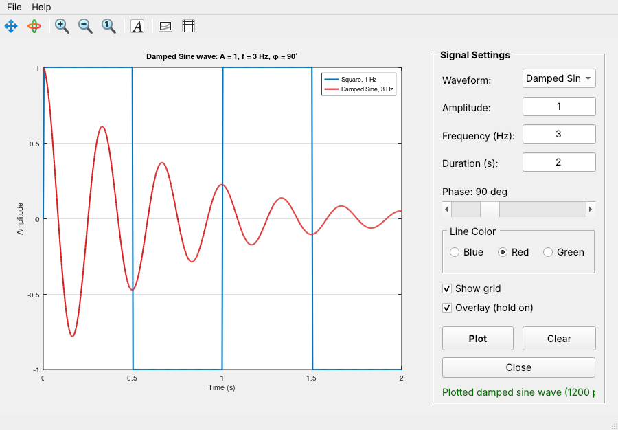

# fam

## Signal Plotter – a MATLAB GUI example

`signal_plotter_gui.m` is a programmatic MATLAB GUI (built in code, no GUIDE
or App Designer file). It shows the usual parts of a MATLAB GUI working
together.



### Running it

```matlab
>> signal_plotter_gui
```

It also runs in GNU Octave (version 6 or newer, with the Qt graphics toolkit).

### What the user can do

| Control | Type | Purpose |
|---|---|---|
| Waveform | `popupmenu` | Sine, Cosine, Square, Sawtooth, Damped Sine |
| Amplitude, Frequency, Duration | `edit` | Numeric inputs, checked before plotting |
| Phase | `slider` + `text` | 0–360°, the label updates while you move the slider |
| Line Color | `uibuttongroup` of `radiobutton`s | Blue / Red / Green |
| Show grid | `checkbox` | Turns the axes grid on or off right away |
| Overlay (hold on) | `checkbox` | Draws new curves on top of old ones, with a legend |
| Plot / Clear / Close | `pushbutton` | Draw, reset the axes, close (asks for confirmation) |
| File menu | `uimenu` | Save the plot as PNG, export `sig_t` / `sig_y` to the workspace, Exit |
| Help menu | `uimenu` | About box |

### How it is built

1. **Layout**: `figure` → `axes` on the left, and a `uipanel` on the right
   holding all the controls. Everything uses `'Units','normalized'`, so the
   window can be resized.
2. **Callbacks**: each interactive control has a `'Callback'` that points to a
   local function (`onPlot`, `onClear`, `onPhaseSlider`, ...).
3. **Shared data**: all handles are stored in a struct `h` with
   `guidata(hFig, h)`. Each callback gets it back with `h = guidata(src)`.
   If a callback changes `h`, it saves it again with `guidata`.
4. **Input checking**: `str2double` returns `NaN` for text that isn't a
   number. Bad values show an `errordlg`, write a red status message, and put
   the cursor back in the bad field.
5. **Dialogs**: `uiputfile`, `msgbox` and `questdlg` are used for saving,
   the About box and confirming close.
